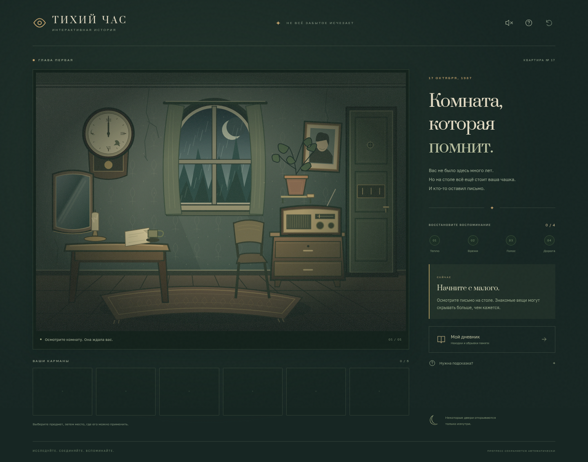

# Тихий час

Законченная небольшая point-and-click игра на русском языке: одна квартира, четыре связанные головоломки и история о возвращении забытого воспоминания. Рассчитана примерно на 10–15 минут.



Сюжет, рисунок комнаты, предметы, загадки и звуковая атмосфера созданы для этого проекта. Игра использует общие приёмы жанра escape room; персонажей, сюжетов и материалов Rusty Lake здесь нет.

## Играть

В ветке `main` находятся и исходники, и готовая игра. Скачайте [quiet-hour.zip](quiet-hour.zip), распакуйте архив и откройте `quiet-hour.html` в Chrome, Edge или Firefox. Также доступен отдельный [quiet-hour.html](quiet-hour.html). Сервер и интернет для игры не нужны; шрифты, иллюстрации, звук и лицензии шрифтов включены в HTML.

При повторной сборке `npm run export` создаёт обновлённый автономный файл в `dist/quiet-hour.html`. Каталог `dist/` не хранится в Git; готовая версия для скачивания лежит в корне репозитория.

Для запуска из исходников нужны Node.js 22.18+ (проверено на 24.19) и npm:

```sh
npm ci
npm run dev
```

Сервер использует порт 5173. `npm run build` создаёт обычную статическую сборку в `dist/`, `npm run preview` запускает её локальную проверку. Базовый путь относительный, поэтому сборку можно размещать в подкаталоге статического хостинга.

Для публикации через GitHub Pages подготовлен `.github/workflows/pages.yml`. В настройках репозитория выберите **Pages → Source → GitHub Actions**, затем отправьте исходники в `main` или запустите workflow вручную. Публикация выполняется после тестов и сборки. Само наличие workflow в локальном checkout не означает, что сайт уже опубликован; рабочий адрес появится в результате успешного шага Deploy game.

## Управление

- Нажимайте на предметы в комнате, чтобы их осмотреть и забрать находки.
- Выберите предмет в карманах, затем нажмите на объект в комнате для применения. Второе нажатие отменяет выбор. Кнопка «Рассмотреть» показывает выбранную находку крупнее.
- Дневник собирает найденные подсказки. Кнопка подсказки раскрывает до трёх всё более конкретных советов для текущего шага.
- Прогресс автоматически сохраняется в `localStorage` этого браузера. При недоступном хранилище можно играть без сохранения.
- Звук включается отдельно; все сведения для решения есть в тексте. `Tab` перемещает фокус, `Enter` и `Space` активируют кнопки, `Esc` закрывает окно или отменяет выбор.
- Новая игра требует подтверждения. Прохождение содержит один финал. Инвентарь, дневник и финал сохраняются после перезагрузки.

## Проверки

```sh
npm test          # 8 проверок правил, прохождения и сохранений
npm run build     # TypeScript и production-сборка
npx playwright install chromium # если в системе ещё нет Chromium
npm run test:e2e  # 3 браузерных сценария, включая полное прохождение
npm run export   # сборка и автономный HTML
```

Браузерные тесты автоматически используют `/usr/bin/chromium`, если он установлен. Другой путь можно задать переменной `CHROMIUM_PATH`. Сценарии проверяют ошибочные решения, все загадки, восстановление сохранения, подтверждение сброса, мобильную ширину, подсказки, клавиатурную навигацию, звук и недоступность хранилища.

## Устройство проекта

- `src/game.ts` — правила игры и проверка сохранений без зависимости от интерфейса.
- `src/main.ts` — интерфейс, действия, дневник и синтез звука через Web Audio.
- `src/art.ts` — авторская SVG-комната, предметы и пиктограммы.
- `src/style.css` — адаптивный интерфейс, локальные шрифты, дождь и огонь; учитывается `prefers-reduced-motion`.
- `scripts/export.mjs` — сборка приложения и шрифтов в один HTML-файл.
- [docs/WALKTHROUGH.md](docs/WALKTHROUGH.md) — полное прохождение со спойлерами.

Бэкенда, сетевых API, аккаунтов и внешних ресурсов во время игры нет. Шрифты Prata и Golos Text поставляются локально пакетами Fontsource под лицензией SIL OFL; лицензии сохранены в зависимостях и описаны в [THIRD_PARTY_NOTICES.md](THIRD_PARTY_NOTICES.md).
